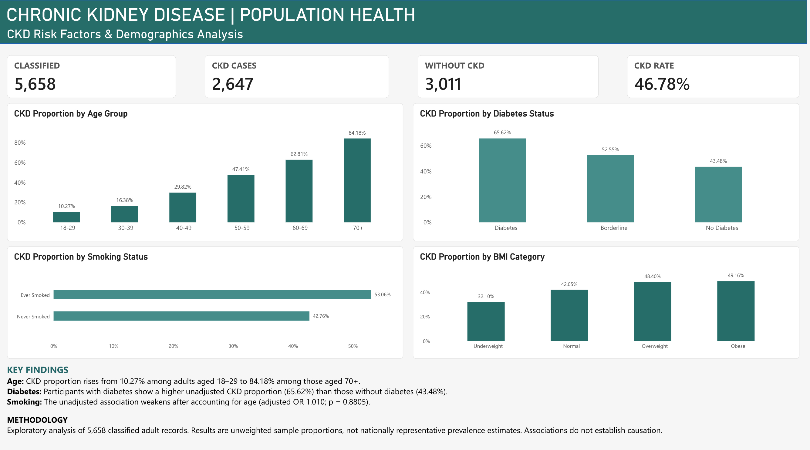

# Chronic Kidney Disease (CKD) | Population Health Analysis

**An end-to-end healthcare analytics project using PostgreSQL, SAS, Tableau, and Power BI.**

## Project Overview

This project explores patterns in chronic kidney disease (CKD) classification across adult participants in a NHANES-derived dataset. PostgreSQL was used for data preparation and exploratory analysis; SAS for statistical tests and age-adjusted models; and Tableau and Power BI for dashboards.

**Objective:** Examine how CKD classification varies by age, diabetes status, smoking history, and body mass index (BMI), while documenting data-quality and interpretation limitations.

## Dashboards

### Tableau — Interactive Dashboard

[**Explore the Tableau dashboard**](https://public.tableau.com/app/profile/ololade.akinsanola/viz/CKDPopulationHealthAnalysis/Dashboard1)


### Power BI — Dashboard Preview

The Power BI report is presented as a static screenshot because external report sharing was not available under the account used.



## Dataset and Tools

- **Source:** *CKD-NHANES 2021–2023: Staged Kidney Disease* (Kaggle; NHANES-derived)
- **Adult analytical dataset:** 8,153 records
- **Known CKD classification:** 5,658 records (2,647 CKD; 3,011 No CKD)
- **Unknown CKD classification:** 2,495 records, excluded from CKD proportion calculations

| Tool | Application |
| --- | --- |
| PostgreSQL | Data exploration, cleaning, validation, derived classifications, and analytical queries |
| SAS | Descriptive statistics, chi-square tests, and age-adjusted logistic regression |
| Tableau | Interactive CKD dashboard |
| Power BI | DAX measures, KPI cards, and comparison charts |

## Key Findings

| Analysis | Finding |
| --- | --- |
| Overall CKD classification | **46.78%** of records with known CKD classification were categorized as CKD (2,647 of 5,658) |
| Age | CKD proportion rose from **10.27%** (ages 18–29) to **84.18%** (ages 70+) |
| Diabetes | **65.62%** for participants reporting diabetes versus **43.48%** for those reporting no diabetes |
| Smoking history | **53.06%** among ever-smokers versus **42.76%** among never-smokers |
| BMI | **32.10%** underweight; **42.05%** normal; **48.40%** overweight; **49.16%** obese |

All proportions above are **unweighted comparisons within the analyzed sample**, not estimates of U.S. population prevalence.

## SAS Statistical Analysis

Chi-square tests found unadjusted associations between CKD classification and diabetes and smoking history in the analyzed sample.

Separate logistic regression models adjusted each risk factor for age:

| Predictor | Age-adjusted odds ratio | p-value |
| --- | ---: | ---: |
| Smoking history | 1.010 | 0.8805 |
| Diabetes status | 1.195 | 0.0516 |

After age adjustment, the smoking association was not statistically significant; the diabetes estimate did not meet the conventional 0.05 significance threshold. Results are exploratory and do not establish causation.

## Methodology and Limitations

1. Restrict the dataset to adults aged **18 or older**.
2. Derive `analytical_ckd_status` from the supplied `ckd_stage` field rather than relying on the original CKD indicator.
3. Exclude `Unknown` CKD classifications from denominators when calculating CKD proportions.
4. Compare known-status groups using SQL and dashboard measures; perform unadjusted chi-square tests and separate age-adjusted logistic regressions in SAS.

**Interpretation:** The **46.78% CKD proportion applies only to classified records in this dataset**. It is **not** a nationally representative CKD prevalence estimate. NHANES survey weights and complex survey design adjustments were not applied. Missing data, excluded unknown classifications, and confounding limit generalizability.

## Repository Structure

```text
CKD-Population-Health-Analysis/
├── sql/          # PostgreSQL scripts
├── sas/          # SAS analysis programs
├── powerbi/      # DAX measures and Power BI documentation
├── tableau/      # Tableau documentation and interactive link
├── images/       # Dashboard screenshots
└── README.md
```

## Explore the Project Files

- [SQL — Cleaning, validation, and exploratory analysis](sql/)
- [SAS — Statistical analysis](sas/)
- [Power BI — DAX measures and dashboard notes](powerbi/)
- [Tableau — Dashboard notes](tableau/)
- [Images — Dashboard previews](images/)

## Conclusion

CKD classification varied substantially across age groups. Unadjusted comparisons also showed differences by diabetes status, smoking history, and BMI, while age-adjusted SAS models highlighted the importance of accounting for confounding. This project demonstrates a workflow from data validation and statistical analysis to clear dashboard communication.
